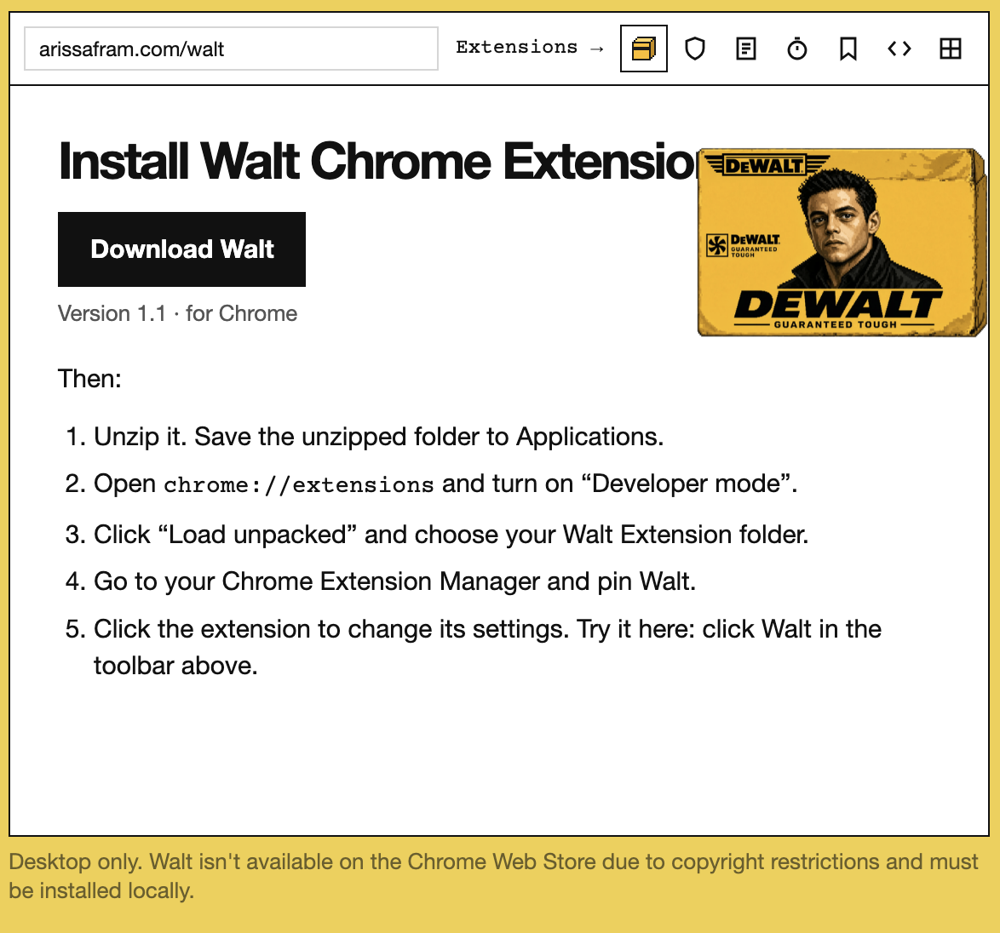

# Walt

A Chrome extension that bounces a box around on top of your pages, like a screensaver.

## Install

1. Download [walt.zip](https://arissafram.com/walt/walt.zip) and unzip it.
2. Open `chrome://extensions` and turn on **Developer mode**.
3. Click **Load unpacked** and choose the unzipped folder.
4. Pin Walt, then click it to pick a box and a mode: **On**, **Off**, or **Detect Sleep** (shows after a stretch of no activity, hides when you move).

## Develop

Load this folder with **Load unpacked**. After changing code, reload it on `chrome://extensions` and refresh open tabs.

- **Add a box:** save a transparent PNG into `boxes/` and add it to `boxes.js`.
- **Release:** bump `"version"` in `manifest.json` and push to `main`.
- **Build the zip locally:** `./scripts/build-zip.sh` (writes `dist/site/`).

## How it connects to arissafram.com

The download page and the demo on arissafram.com come from this repo:

- Pushing to `main` builds `walt.zip` and copies it into `personal-site` (needs the `WALT_CREDENTIALS` token secret).
- `site-bridge.js` lets the download page see which version you have installed.
- The site's demo imports the boxes and bounce settings from `index.js`.
